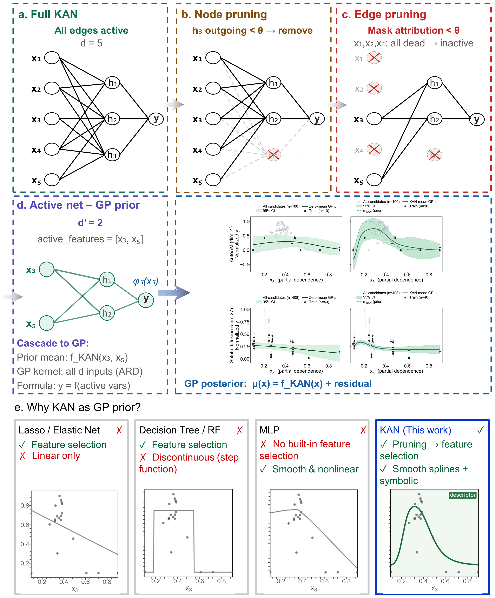
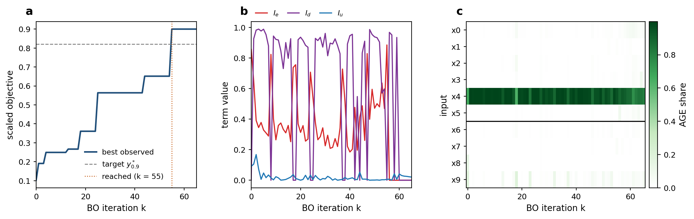
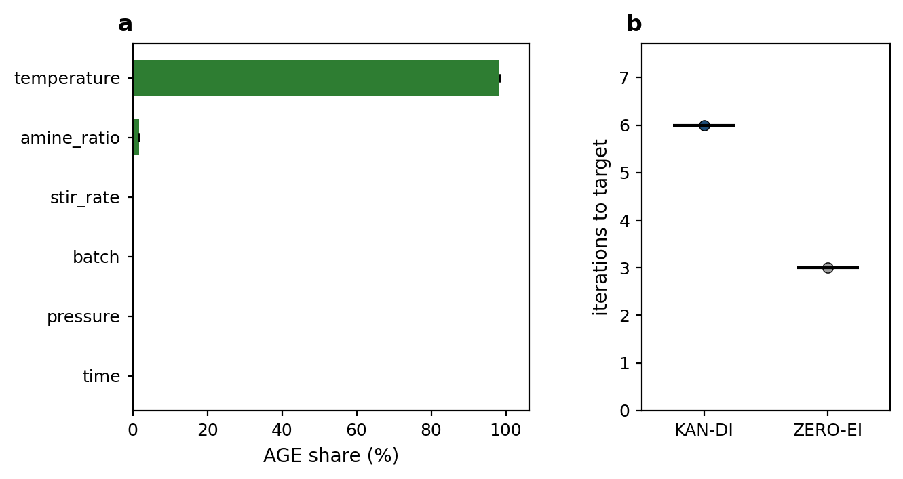

# KAN-DI: Discriminative Bayesian Optimization with a Kolmogorov–Arnold Prior

[](https://github.com/nicechoi99/kan-di/actions/workflows/ci.yml)
[](https://colab.research.google.com/github/nicechoi99/kan-di/blob/main/examples/kan_di_colab.ipynb)
[](https://doi.org/10.5281/zenodo.22652792)
[](https://opensource.org/licenses/MIT)
[](https://www.python.org/downloads/)

Reference implementation of the paper *Experimental Design for Descriptor Discovery: Kolmogorov–Arnold Prior with Discriminative Bayesian Optimization*.

## Overview

- **KAN-DoE** is the framework of the paper. **KAN-DI** is its discriminative composite acquisition. The reported variant is `DI-UCB-H`.
- A Kolmogorov–Arnold network (KAN) is fitted to the measurements, pruned, and used as the prior mean of a Gaussian process (GP).
- The derivatives of the pruned KAN rank the descriptors by average gradient energy (AGE).
- The acquisition `α(x) = I_e(x) + I_d(x) + I_u(x)` selects the next experiment from a discrete candidate pool.

## Method

<p align="center">
  
</p>

Supplementary Fig. S1 of the paper.

- **a** Full KAN with five inputs.
- **b** Node pruning with threshold θ.
- **c** Edge pruning; inputs without active edges become inactive.
- **d** The pruned KAN as the GP prior mean `m(x) = f_KAN(x)`; the GP kernel spans all inputs with ARD lengthscales.
- **e** Properties of four surrogate families as GP prior means.

### Components

- **Prior mean.** `m(x) = f_KAN(x)`; the GP models the residual `y − f_KAN(x)` (`common/models.py:KANMean`).
- **AGE.** Mean of `(∂f_KAN/∂x_i)²` over the scaled input domain, estimated by stratified sampling (`common/models.py:eval_AGE_numeric`).
- **Acquisition** (`common/models.py:eval_DI`).
  - `I_e`, exploitation: GP upper confidence bound `μ(x) + σ(x)`, normalized by the objective range; gated once the best observation exceeds `y_0.9*`.
  - `I_d`, discrimination: `δ₁(x) / (δ₁(x) + δ₂(x))` with `δᵢ(x) = (∂f_KAN/∂x_i)²` for the two leading descriptors; gated once no candidate exceeds the measured maximum of `δ₁`.
  - `I_u`, uniformity: distance to the nearest measured point along the leading descriptor, normalized by its range.
- **Variants.** `DI-EI`, `DI-UCB-L` and `DI-TS` are also implemented.

### Settings

- Descriptors and objective scaled to `[0.1, 0.9]`.
- GP kernel: Matérn-5/2 with ARD.
- KAN: LBFGS, 100 training and 50 retraining steps, followed by pruning.
- Target `y_0.9* = 0.82`; initial design of 10 experiments.

## Installation

```bash
git clone https://github.com/nicechoi99/kan-di.git
cd kan-di
conda create -n kandi python=3.12
conda activate kandi
pip install -r requirements.txt
pip install -r requirements-optional.txt   # optional
```

- `requirements.txt`: `torch`, `gpytorch`, `linear-operator`, `sympy`, `scikit-learn`, `numpy`, `pandas`, `scipy`, `matplotlib`, `tqdm`, `PyYAML`, `dill`.
- `requirements-optional.txt`:

| Group | Packages | Used by |
|---|---|---|
| Plotting | `imageio`, `colorcet` | GIF export of monitoring frames; discrete palette |
| Embedding | `umap-learn`, `pacmap` | `datamanager.preprocessing` |
| Parallel backend | `ray` | detected by `putils`; execution in this release is serial |

- GPU build of PyTorch (install before `requirements.txt`):

```bash
pip install torch==2.5.1 --index-url https://download.pytorch.org/whl/cu121
```

## Usage

### Quickstart

```bash
cd benchmark
python quickstart.py                        # Hartmann-6 with four irrelevant inputs, one seed
python quickstart.py --dummy 0 --compare    # without padding, with the zero-mean baseline
```

- Requires no external data.
- Synthetic functions spread gradient energy across all inputs (Gini < 0.24); they are the contrast case of the paper.
- The quickstart verifies the implementation. The benchmark results of the paper are obtained on the nine pools under `dat/`.

<p align="center">
  
</p>

One quickstart run (400 candidates, seed 0), regenerated by `docs/make_readme_figures.py`.

- **a** Best observation; the target is reached at iteration 55.
- **b** Acquisition terms at the selected point.
- **c** AGE share per input; `x0`–`x5` are genuine and `x6`–`x9` are padded.

### Benchmark sweep

```bash
cd benchmark
python main.py --dataset small_feature --data AutoAM --methods KAN:DI-UCB-H,ZERO:EI --seeds 10
python main.py                              # all methods, all high-dimensional pools, 10 seeds
```

- Runs are saved under `dat/<group>/temp/` and skipped on later calls (`--force` reruns them).
- Convergence is the first iteration whose proposal exceeds `y_0.9*`.
- Execution is serial (`common/putils.py`).

### Analysis of a user dataset

```bash
python analyze.py data.csv --target yield                        # descriptor importance
python analyze.py data.csv --target yield --features T,P,ratio   # selected descriptors
python analyze.py data.csv --target impurity --minimize          # minimization
python analyze.py data.csv --target yield --simulate --seeds 5   # simulated optimization runs
```

- **Input.** CSV or Excel; one row per experiment, numeric descriptors, one response column.
- **Descriptor importance.** AGE share of each descriptor over `--fits` KAN initializations (default 3), with the R² of each expression.
- **Input transform.** `--log-inputs auto` selects the log transform by held-out R²; `on` or `off` fixes it.
- **Simulated optimization** (`--simulate`). KAN-DI and ZERO-EI on the supplied rows as the candidate pool, from random initial designs (`--n-initial`, default 10).
- **Output** (`results_<file name>/` or `--out`): `report.txt`, `descriptor_importance.csv`, `campaign_replay.csv`, `summary.png`.
- **Colab.** `examples/kan_di_colab.ipynb` runs the same analysis.

### Example: AutoAM

```bash
python analyze.py dat/small_feature/AutoAM.csv --target Score --log-inputs on
```

<p align="center">
  
</p>

- `X Offset Correction` and `Y Offset Correction` rank first and second, as identified in the paper.
- Bars show the mean over three KAN fits; error bars show one standard deviation.
- Exact shares vary across fits and platforms.

## Reported results

Median BO iterations to reach `y_0.9*` (10 initial designs per method):

| Dataset | d | KAN-DI (`DI-UCB-H`) | Best zero-mean baseline | KAN prior with EI |
|---|---|---|---|---|
| AutoAM | 4 | 5 | 23 (ZERO-TS) | 8.5 (KAN-EI) |
| MOF `T_d` | 50 | 16 | 42 (ZERO-EI) | 128.5 (KAN-EI) |

```bash
cd benchmark
python paper_results.py                                        # all pools and methods
python paper_results.py --data AutoAM,MOF_Td --methods KAN-DI-UCB-H,ZERO-EI,KAN-EI
python paper_results.py --per-seed --data AutoAM               # one row per seed
```

- `paper_runs/bo_runs_<group>.csv` records every proposal of the benchmark runs (9 pools × 9 methods × 10 seeds).
- Each row holds the selected candidate, its objective, the acquisition value and, for DI acquisitions, `I_e`, `I_d`, `I_u` and the two leading descriptors.
- Runs that ended in an error are excluded; `paper_results.py` reports the seed count.
- Reruns reproduce the distributions over seeds; individual runs can differ across hardware and software environments because pruning near the threshold can select different descriptors.

## Implementation notes

- **`I_u` column indexing.** The benchmark runs evaluate `I_u` on column `j1`, the position of the leading descriptor among the expression symbols. This equals the input column when the active descriptors are in input order. `KANDOE_IU_FIX=1` selects the input column `zindices[j1]`. The default reproduces the reported runs.
- **Constant derivatives (1.0.2).** A constant partial derivative is broadcast in `eval_func`.

## Data availability

- **Low-dimensional pools** (d = 3–5; AgNP, AutoAM, P3HT, Perovskite, Crossed barrel): Liang et al., *npj Comput. Mater.* **7**, 188 (2021).
- **High-dimensional pools** (d = 22–50):
  - dilute-solute diffusion: Wu, Mayeshiba & Morgan, *Sci. Data* **3**, 160054 (2016)
  - metallic-glass forming: Ward et al., *npj Comput. Mater.* **2**, 16028 (2016)
  - MOF `T_d`: Nandy, Duan & Kulik, *J. Am. Chem. Soc.* **143**, 17535 (2021)
  - polymer `C_p`: Kim et al., *J. Phys. Chem. C* **122**, 17575 (2018)
- **Synthetic functions** (Rastrigin, Hartmann-6, Griewank, Rosenbrock, Ackley): `common/datamanager.py:gen_benchmark_functions`.
- Preprocessing, sources and licenses: `dat/README.md`.

## Repository layout

```
analyze.py                 descriptor importance and simulated optimization for a user dataset
common/
  models.py                DiscreteBO, KANMean, ExactGPModel, eval_DI, AGE evaluation
  config.py                datasets, method combinations, ranges
  datamanager.py           dataset loading and synthetic functions
  utils.py, plotter.py     utilities and monitoring plots
  putils.py                serial execution backend
  kan/                     KAN implementation
benchmark/
  quickstart.py            example without external data
  main.py                  benchmark sweep on the pools under dat/
  paper_results.py         reported convergence results from paper_runs/
paper_runs/                records of the benchmark runs
dat/                       nine benchmark pools, embeddings and KAN settings
examples/                  AutoAM example and Colab notebook
tests/smoke_test.py        CI check
docs/                      README figures and their script
requirements.txt           core dependencies
requirements-optional.txt  optional dependencies
CITATION.cff, LICENSE, NOTICE
```

## License

- MIT (`LICENSE`).
- The KAN implementation in `common/kan/` derives from [pykan](https://github.com/KindXiaoming/pykan) (MIT); see `NOTICE`.

## Citation

- Paper: manuscript submitted.
- Software: Choi, J., Park, D., Kim, K. & Lee, U. *KAN-DI: Discriminative Bayesian Optimization with a Kolmogorov–Arnold Prior*. Zenodo, https://doi.org/10.5281/zenodo.22652792.
- The concept DOI resolves to the latest release. Metadata: `CITATION.cff`.
